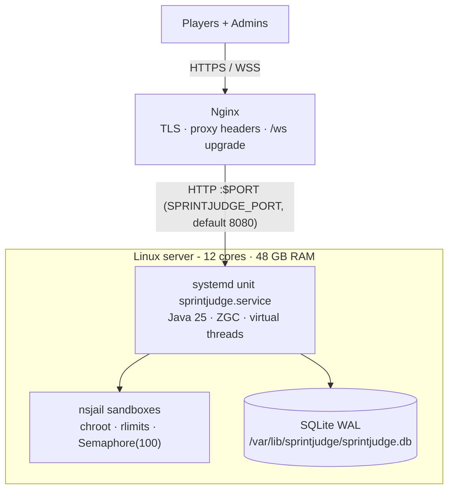
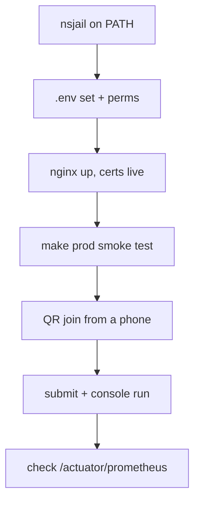

# Deployment

## Production topology



## Windows production

`prod` runs on Windows too. The `native` executor drives gcc/g++/javac/node/python
directly (no nsjail on Windows), and the database defaults to a portable relative path.

```bash
make prod          # builds target/sprintjudge.jar and starts it with ZGC
# optional environment:
#   SPRINTJUDGE_DB_PATH=D:\data\sprintjudge.db
#   SPRINTJUDGE_PORT=8080
#   SPRINTJUDGE_EXECUTOR_MODE=native
```

The parent directory of `SPRINTJUDGE_DB_PATH` is created automatically on first boot.
Without an explicit path, the database (and a `.env` file if present) lives next to
the running jar, so the whole deployment is one folder you can copy around.
Verify any Windows launch in one command:

```bash
make verify-prod SKIP_BUILD=1   # boots prod, checks the REST health endpoints
```

For hardened Linux hosts keep `SPRINTJUDGE_EXECUTOR_MODE=nsjail` (the systemd unit already
pins it); on Windows, prefer running the JVM under a dedicated service account and rely
on the executor's whitelist, source cap, timeout-kill, and stdout-cap controls.

## Production (Linux — 12 cores / 48GB RAM)

- Run as a systemd service (see `deploy/sprintjudge.service`) with `-XX:+UseZGC` and virtual threads.
- The unit pins `--sprintjudge.executor.mode=nsjail` and reads an optional
  `/opt/sprintjudge/.env` for PORT, DB path and admin credentials.
- Nginx reverse proxy terminates TLS and upgrades `/ws` to WebSocket (see `deploy/nginx-sprintjudge.conf`).
  Both locations forward `X-Forwarded-For`/`X-Real-IP` so rate limiting sees
  real client IPs. Upstream is `127.0.0.1:8080` — match it with SPRINTJUDGE_PORT.
- Set `SPRINTJUDGE_COOKIE_SECURE=true` behind TLS nginx.
- Use the `prod` profile: `SPRINTJUDGE_EXECUTOR_MODE=nsjail`, executor `nsjail` binary on `PATH`.
- Weekly SQLite WAL checkpoint:

```bash
sqlite3 /var/lib/sprintjudge/sprintjudge.db "PRAGMA wal_checkpoint(TRUNCATE);"
```

## Backup, restore, upgrade

`make backup-db` uses `sqlite3 .backup`, which produces a consistent single
file while the server is running (WAL included). `make restore-db` replaces the
database; stop the service first.

```bash
make backup-db DB=/var/lib/sprintjudge/sprintjudge.db OUT=backups/before-upgrade.db
sudo systemctl stop sprintjudge
make restore-db FILE=backups/before-upgrade.db DB=/var/lib/sprintjudge/sprintjudge.db
sudo systemctl start sprintjudge
```

Upgrade:

1. `make backup-db`
2. Replace `sprintjudge.jar`.
3. `sudo systemctl restart sprintjudge`
4. Probe `curl -fsS http://127.0.0.1:8080/actuator/health` and open one quiz.

Rollback: stop the service, restore the backup, put the previous jar back,
start, and probe health again. SQLite migrations are forward-only, so a jar
rollback without the matching database backup is not supported.

## Verified on Linux (WSL Ubuntu 24.04, 2026-10-30)

- `bash -n` passes for `scripts/backup-db.sh`, `scripts/restore-db.sh`, and `deploy/health-check.sh`.
- `systemd-analyze` and `nginx` are not installed in the WSL image used, so the unit and reverse-proxy configs were not machine-verified here; review them by hand before go-live.
- OpenJDK 25 is not available in the Ubuntu 24.04 archive (only OpenJDK 21), so the production jar was not booted under Linux on this host. Boot it on the target host with the bundled `make prod` flow and probe `/actuator/health`.
- The jar builds and boots on Windows with the `prod` profile (see `make verify-prod`).

## Public runner policy

`POST /api/public/run` is refused with 403 in the `prod` profile unless
`SPRINTJUDGE_EXECUTOR_MODE=nsjail`. In development it stays available with the
native toolchain. This keeps an unsandboxed execution endpoint off a production
host by default.

## Load probe

With a seeded backend running, probe 30 players and broadcast latency:

```bash
node scripts/load-test.mjs 30
```

The script joins a real practice room, submits one answer, and prints join,
question-start, and reveal percentiles plus any dropped clients. It exits
non-zero on a drop, so it can gate a classroom pilot.

## Security notes

- CSRF is enforced on `/api/admin/**`; the SPA echoes `XSRF-TOKEN` automatically.
  Public endpoints and the WebSocket handshake stay exempt.
- The CSP no longer allows inline or `data:` scripts.
- The service refuses to boot in `prod` with the default admin password.
- Set `SPRINTJUDGE_COOKIE_SECURE=true` behind TLS and keep HSTS enabled only
  when nginx terminates TLS.

Go-live checklist:



## Development (Windows)

- Use the `dev` profile; the executor defaults to `native` toolchains, with WSL2
  Ubuntu opt-in via `SPRINTJUDGE_EXECUTOR_MODE=wsl`.
- `spring.profiles.active=dev`.

## Concurrency

Executions are throttled by an auto-sized semaphore (`cores ×
sprintjudge.executor.concurrency-factor`, floor 8, cap 512; override with
`sprintjudge.executor.max-concurrent`).
Stdout is capped at 1MB per test case; processes exceeding it are killed. Source is capped
at 64KB and attempts at 50 per player per question.

## Proxy headers

The WebSocket rate limiter keys on `X-Forwarded-For` (falling back to `X-Real-IP`).
Configure nginx to set both so per-client limiting is accurate:

```
proxy_set_header X-Forwarded-For $proxy_add_x_forwarded_for;
proxy_set_header X-Real-IP $remote_addr;
```

## Upgrade and rollback (production)

### Pre-upgrade

1. Verify the toolchain on the host:
   ```bash
   java -version          # JDK 25 LTS
   command -v nsjail && nsjail --version
   systemctl is-active sprintjudge
   ```
2. Take a WAL-safe backup:
   ```bash
   make backup-db DB=/var/lib/sprintjudge/sprintjudge.db OUT=backups/pre-upgrade-$(date +%Y%m%d-%H%M%S).db
   ```
3. Record the current jar checksum for rollback:
   ```bash
   sha256sum /opt/sprintjudge/sprintjudge.jar > /opt/sprintjudge/sprintjudge.jar.sha256
   ```

### Upgrade

1. Stop the service: `sudo systemctl stop sprintjudge`.
2. Replace `sprintjudge.jar` (and the SPA assets inside it).
3. Start: `sudo systemctl start sprintjudge`.
4. Probe: `curl -fsS http://127.0.0.1:8080/actuator/health` and run `deploy/health-check.sh`.
5. Open one quiz end to end (join, submit, console run).

### Rollback

SQLite migrations are forward-only, so a jar rollback requires the matching
database backup.

1. `sudo systemctl stop sprintjudge`.
2. Restore the database: `make restore-db FILE=backups/pre-upgrade-*.db DB=/var/lib/sprintjudge/sprintjudge.db`.
3. Put the previous jar back (use the recorded checksum / a saved copy).
4. `sudo systemctl start sprintjudge`.
5. Probe health and run `deploy/health-check.sh`.

### Health checks

- HTTP: `curl -fsS http://127.0.0.1:8080/actuator/health` (expect `{"status":"UP"}`).
- Database: `sqlite3 /var/lib/sprintjudge/sprintjudge.db 'PRAGMA integrity_check;'` (expect `ok`).
- Executor: `command -v nsjail && nsjail --version`.
- Combined: `deploy/health-check.sh` (exits non-zero on any failure).

### Log rotation

- App logs go to journald by default (`journalctl -u sprintjudge -f`).
- File-based logs and nginx vhost logs rotate via `deploy/sprintjudge.logrotate`
  (install to `/etc/logrotate.d/sprintjudge`).

### Firewall (LAN port)

The app listens on `:8080` locally and nginx on `:80`/`:443`. Only expose what
the clients need. Example with ufw:

```bash
sudo ufw default deny incoming
sudo ufw default allow outgoing
sudo ufw allow 22/tcp          # SSH (restrict to admin subnet if possible)
sudo ufw allow 80/tcp          # HTTP (redirect to HTTPS)
sudo ufw allow 443/tcp         # HTTPS / WSS
# Do NOT expose 8080 publicly; nginx is the only client on localhost.
sudo ufw deny 8080/tcp
sudo ufw enable
sudo ufw status verbose
```

For an intranet deployment without TLS, use the plain-HTTP server block in
`deploy/nginx-sprintjudge.conf` (commented) and set
`SPRINTJUDGE_COOKIE_SECURE=false`. Do not enable HSTS in that case.

### TLS policy

- Production: TLS terminates in nginx (Let's Encrypt). Set
  `SPRINTJUDGE_COOKIE_SECURE=true`.
- Intranet: plain HTTP on a trusted LAN is acceptable; keep HSTS disabled and
  cookies non-secure. Document the choice in the host's runbook.
